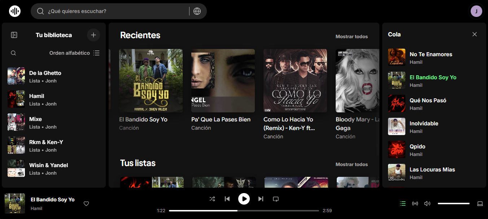

# Spoty - Clone de Spotify



## 📝 Descripción
Spoty es un clon de Spotify desarrollado con React y TypeScript, pensado para replicar la experiencia principal de reproducción y exploración musical en una interfaz moderna y responsiva.

## ✨ Características

- Inicio de sesión y autenticación de usuarios.
- Home con bienvenida personalizada, artistas destacados, recientes y playlists del usuario.
- Exploración de música por artistas, canciones, playlists y contenido reciente.
- Búsqueda avanzada por término y navegación en vistas dedicadas.
- Biblioteca personal con acceso a contenido guardado y playlists del usuario.
- Reproductor multimedia con controls de play/pause, siguiente/anterior, shuffle, repeat y progreso.
- Gestión de playlists y vistas de detalle para cada colección musical.
- Páginas para artistas, canciones y historial de reproducción.
- Diseño adaptativo para desktop y mobile con estilo inspirado en Spotify.
- Integración con Supabase para almacenamiento y flujo de datos del usuario.

## 🛠 Tecnologías

- **React 19** y **TypeScript**
- **Vite 8** para desarrollo y compilación
- **React Router** para navegación
- **Tailwind CSS 4** para estilos
- **Supabase JS** para servicios de almacenamiento
- **Axios** para consumo de APIs
- **Motion** para animaciones
- **Lucide React** para iconografía
- **Sonner** para notificaciones
- **yarn** para gestión de dependencias

## 🚀 Instalación y ejecución

### 📍 Requisitos

- Node.js 18+
- yarn, npm o pnpm
- Variables de entorno configuradas en un archivo `.env`

### 📋 Pasos

1. Clona el repositorio y entra en la carpeta del proyecto:

   ```bash
   git clone <URL_DEL_REPOSITORIO>
   cd app
   ```

2. Instala las dependencias:

   ```bash
   yarn
   ```

3. Crea el archivo local de variables de entorno a partir de la plantilla:

   ```bash
   cp .env.template .env
   ```

   En Windows PowerShell, puedes usar:

   ```powershell
   Copy-Item .env.template .env
   ```

4. Configura las variables de entorno en `.env` con tus valores reales:

   ```dotenv
   VITE_REACT_ENV=dev
   VITE_MODE=dev

   VITE_API_URL=http://localhost:3000/api

   VITE_SUPABASE_URL=
   VITE_SUPABASE_PUBLISHABLE_KEY=

   VITE_DEMO_USER='{
     "email": "demo@example.com",
     "pass": "password"
   }'
   ```

5. Inicia el servidor de desarrollo:

   ```bash
   yarn dev
   ```

6. Si deseas compilar la versión de producción:

   ```bash
   yarn build
   ```

## 📂 Estructura del proyecto

```text
.
├── public/                # Recursos estáticos
├── src/
   ├── App.tsx            # Componente raíz con providers
   ├── main.tsx           # Punto de entrada de React
   ├── index.css          # Estilos globales
   ├── assets/            # Imágenes, logos y estilos compartidos
   ├── features/
   │   ├── artist/        # Páginas y lógica de artistas
   │   ├── auth/          # Autenticación y sesión de usuario
   │   ├── home/          # Inicio, recientes, playlists y banners
   │   ├── library/       # Biblioteca personal
   │   ├── player/        # Estado y controles del reproductor
   │   ├── playlist/      # Playlists y detalles
   │   ├── search/        # Búsqueda y resultados
   │   └── song/          # Canciones y reproducción
   ├── routes/
   │   ├── AppRouter.tsx
   │   ├── AppRoutes.tsx
   │   └── AuthRoutes.tsx
   ├── shared/
      ├── components/    # Componentes reutilizables
      ├── context/       # Contextos globales de app
      ├── data/          # Datos y presets reutilizables
      ├── hooks/         # Hooks compartidos
      ├── layout/        # Layout general y navegación
      └── utils/         # Helpers y utilidades
```